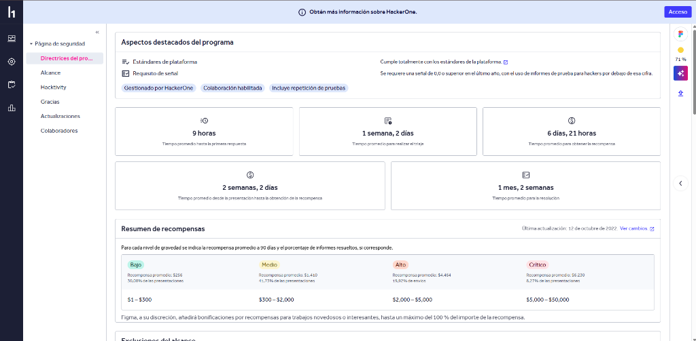
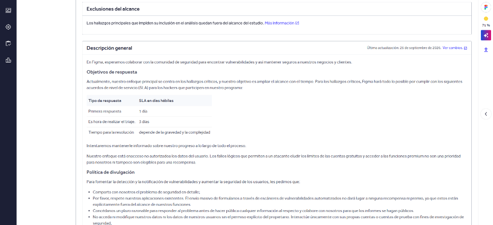
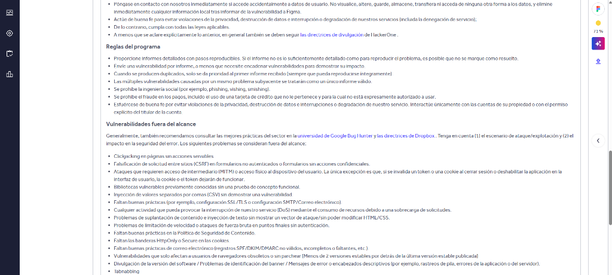
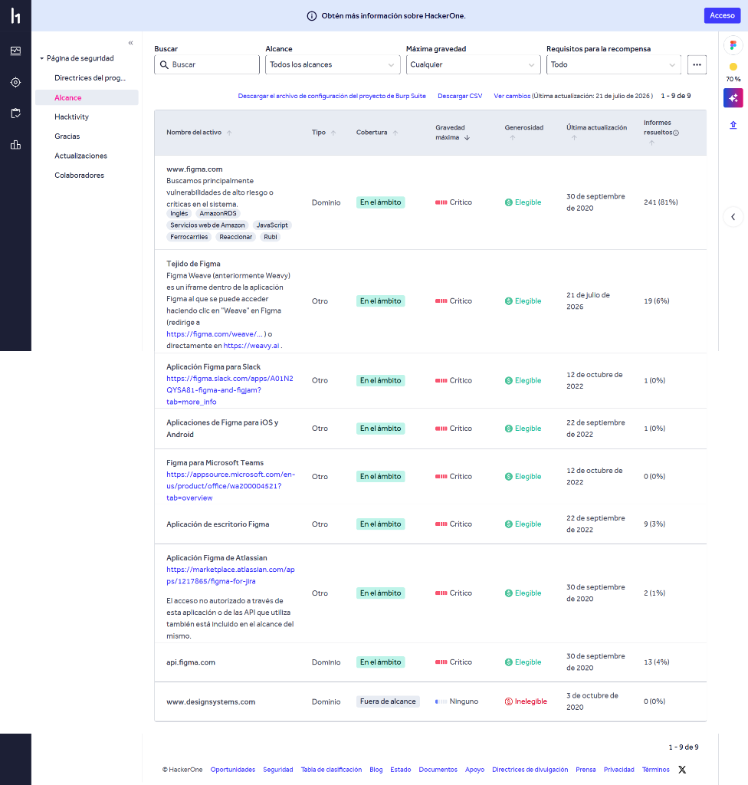

# 1.2 Alcance del Proyecto: Figma Inc.

- **Organización / Programa:** Figma Inc.
- **Plataforma:** HackerOne
- **Enlace al programa oficial:** [https://hackerone.com/figma](https://hackerone.com/figma)
- **Fecha de consulta:** 28 de octubre de 2026

---

## 1. Dentro del Alcance (In-Scope)

Según la tabla oficial de activos de HackerOne, los siguientes elementos están formalmente en el ámbito:

| Activo | Tipo | Cobertura | Gravedad Máxima | Elegibilidad |
| :--- | :--- | :--- | :--- | :--- |
| `www.figma.com` | Dominio | En el ámbito | Crítico | Elegible |
| `api.figma.com` | Dominio | En el ámbito | Crítico | Elegible |
| `weavy.ai` (Tejido Figma / Weave) | Web / Iframe | En el ámbito | Crítico | Elegible |
| Aplicación de escritorio Figma | Aplicación | En el ámbito | Crítico | Elegible |
| Aplicaciones para iOS y Android | Móvil | En el ámbito | Crítico | Elegible |
| Integraciones oficiales (Slack, Teams, Atlassian Jira) | Integraciones | En el ámbito | Crítico | Elegible |

---

## 2. Fuera del Alcance (Out-of-Scope)

Quedan expresamente excluidos:
- **`www.designsystems.com`** (Dominio marcado explícitamente como **Fuera de alcance / Inelegible** en la tabla oficial de HackerOne).
- Servicios de terceros integrados (ej: centros de soporte en Zendesk, statuspage, etc.).
- Ataques de **Denegación de Servicio (DoS / DDoS)**.
- **Ingeniería social**, phishing o ataques directos a empleados o contratistas.
- Acceso, modificación o exfiltración de datos ajenos.

---

## 3. Reglas Específicas que Afectan a Este Proyecto

En base a la política oficial de HackerOne de Figma y las instrucciones específicas del profesor:

### 3.1 ¿Permite herramientas automáticas?
- **Según el programa de Figma:** Solo están permitidas si se usan con **moderación estricta**. Queda prohibido el uso de escáneres masivos descontrolados (como Nessus, Acunetix o sqlmap a gran escala) que puedan degradar el rendimiento o generar ruido excesivo.
- **Según las reglas de este proyecto escolar:** Para esta práctica **NO se permite el uso de escáneres activos ni fuerza bruta** (eso pertenece a la UD2). Solo se autoriza la **recolección de información pasiva** (consultas públicas vía OSINT, `subfinder`, certificados SSL, `whois`, etc.).

### 3.2 ¿Existe límite de peticiones (Rate Limiting)?
- **Sí.** Figma exige no saturar sus servidores con tráfico concurrente agresivo.
- En este proyecto nos ceñimos a peticiones espaciadas y no intrusivas para no activar los bloqueos de AWS WAF ni provocar cortes de servicio.

### 3.3 ¿Prohíbe contactar con empleados?
- **Sí, rotundamente prohibido.**
- Tanto la política de HackerOne como las normas del centro prohíben explícitamente cualquier forma de **ingeniería social**, llamadas, correos electrónicos o contacto directo con trabajadores o colaboradores de Figma.
- No se deben crear cuentas falsas para interactuar con empleados ni enviar mensajes de prueba.

### 3.4 ¿Existe algún requisito de identificación?
- **Sí, en auditorías activas:** Los investigadores en HackerOne suelen tener que identificarse incluyendo cabeceras HTTP personalizadas en sus peticiones (por ejemplo, cabeceras del tipo `X-Bug-Bounty: hackerone-<username>`) o registrarse previamente con el correo vinculado a su perfil de investigador.
- **En nuestro proyecto:** Al trabajar estrictamente en **modo pasivo** sobre registros públicos (sin interactuar directamente con los servidores web de Figma ni enviar tráfico de explotación), no se requiere autenticación ni crear cuentas en sus plataformas.

### 3.5 Política ante hallazgos sensibles o graves
- Si durante la búsqueda en fuentes abiertas apareciera por error un panel expuesto, credenciales o datos personales de terceros:
  - **No se explota ni se descarga.**
  - Se toma nota del hallazgo de forma anonimizada, se notifica inmediatamente al profesor y, si procede, se reporta a través del canal formal de HackerOne.

---

## 4. Evidencias Gráficas (Capturas del Programa y Activos)

### 4.1 Resumen y Recompensas del Programa (HackerOne)

  

### 4.2 Objetivos de Respuesta y Política de Divulgación

  

### 4.3 Reglas del Programa y Exclusiones Específicas

  

### 4.4 Tabla Detallada de Activos (In-Scope y Out-of-Scope)

  

  <em>(Evidencia de la tabla oficial de HackerOne donde se aprecia <code>www.figma.com</code> y <code>api.figma.com</code> en el ámbito, y <code>www.designsystems.com</code> fuera de alcance).</em>

