# Cuaderno de Trabajo: Reconocimiento Pasivo sobre Figma Inc.

- **Objetivo:** Figma Inc. (`figma.com`)
- **Estudiante:** Natalia Alejo Pérez (Alumno 20)
- **Alcance:** Definido en `scope.txt` (`*.figma.com`, `weavy.ai`, `!www.designsystems.com`)
- **Metodología:** Cinco anotaciones por acción (`cuándo` · `objetivo y alcance` · `qué hice` · `qué salió` · `siguiente paso`).

---

## Entrada 01 · Alcance y Marco Legal (HackerOne)
- **Cuándo:** 2026-10-28 10:35
- **Objetivo:** `figma.com` (In Scope)
- **Qué hice:** Consulta y lectura de la política pública de Bug Bounty de Figma en HackerOne (`https://hackerone.com/figma`). Extracción de reglas de compromiso, activos autorizados y exclusiones.
- **Qué salió:** Cobertura amplia para `*.figma.com`, APIs (`api.figma.com`) y `weavy.ai`. Exclusión explícita de `www.designsystems.com` y servicios de terceros. Prohibición de DoS, fuerza bruta agresiva e ingeniería social a empleados.
- **Evidencia:**
  <p align="center">
    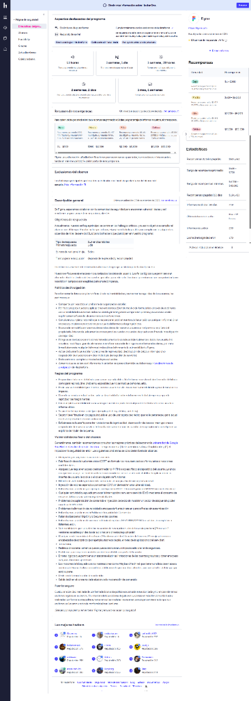
  </p>
  <p align="center">
    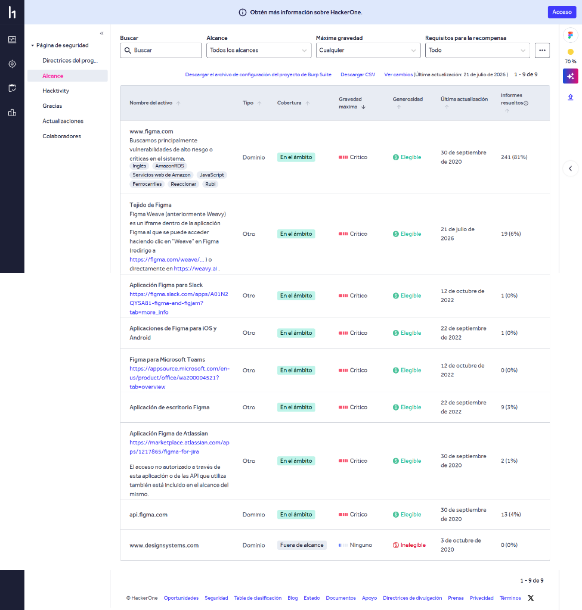
  </p>
- **Siguiente paso:** Crear `scope.txt` formal y comenzar la enumeración DNS pasiva.

---

## Entrada 02 · Conexión al Laboratorio y Resolución DNS (Técnica 2)
- **Cuándo:** 2026-11-02 19:24
- **Objetivo:** `figma.com` (In Scope)
- **Qué hice:** Activación de la VPN WireGuard para acceso remoto al entorno del centro, conexión SSH al contenedor de laboratorio (`alumno@172.26.0.55`) y consulta DNS:
  ```bash
  host figma.com
  ```
- **Qué salió:** 
  - **Registros A (IPv4):** `3.174.170.3`, `3.174.170.84`, `3.174.170.42`, `3.174.170.18` (clúster de balanceo en AWS `us-east-2`).
  - **Registros MX:** Gestionados por Google Workspace (`aspmx.l.google.com`, `alt1.aspmx.l.google.com`, `alt2...`, prioridad 1, 5 y 10).
  - **Parámetros ALPN:** Soporte de protocolos modernos HTTP/2 y HTTP/3 (`h2,h3`).
- **Evidencia:**
  <p align="center">
    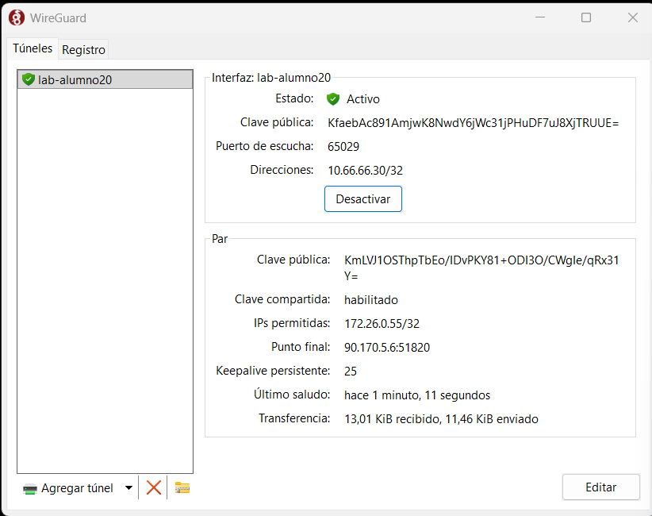
  </p>
  <p align="center">
    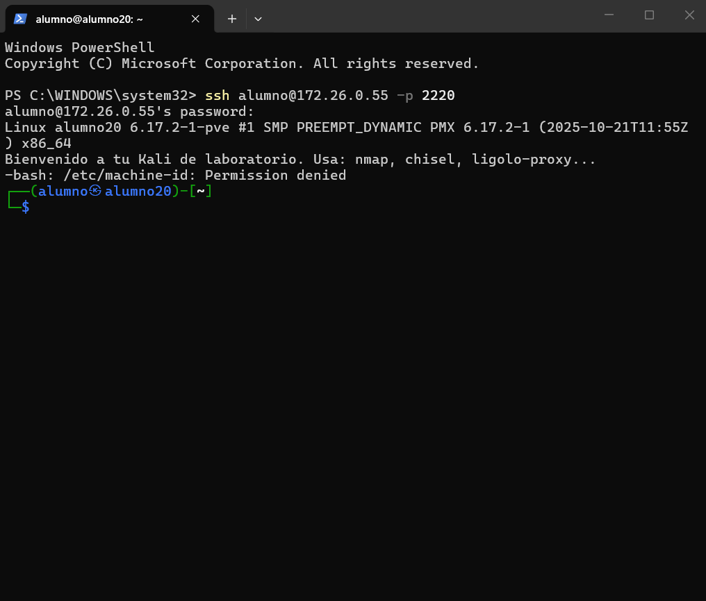
  </p>
  <p align="center">
    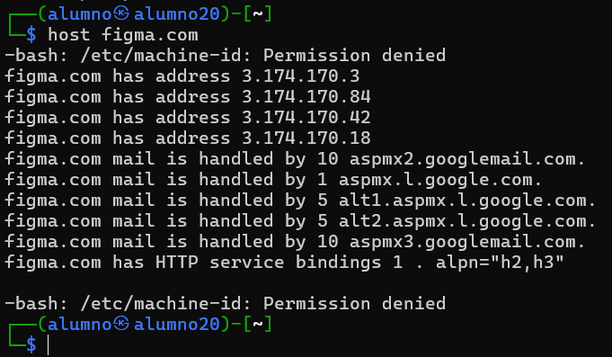
  </p>
- **Siguiente paso:** Descubrimiento pasivo de subdominios con `subfinder`.

---

## Entrada 03 · Descubrimiento de Subdominios (Técnica 3)
- **Cuándo:** 2026-11-02 19:33
- **Objetivo:** `figma.com` (In Scope: `*.figma.com`)
- **Qué hice:** Ejecución de enumeración pasiva multafuente mediante `subfinder` en la terminal del laboratorio:
  ```bash
  subfinder -d figma.com -silent -o subdominios.txt
  wc -l subdominios.txt; head -n 15 subdominios.txt
  ```
- **Qué salió:** 
  - Se descubrieron **100 subdominios únicos** en total.
  - **Entornos sensibles de desarrollo / staging:** `staging-admin.figma.com`, `artifactory.staging.figma.com`, `schema-staging.figma.com`, `cortex-trace-viewer-dev.staging.figma.com`.
  - **Servicios de producción e infraestructura interna:** `api.figma.com`, `admin.figma.com`, `figma-for-jira.figma.com`, `artifactory.prod.figma.com`, `status.figma.com`.
  - **Almacenamiento S3 / CDN:** Múltiples proxies y buckets (`s3-figma-plugin-images-production-sig.figma.com`, `api-cdn.figma.com`).
- **Evidencia:**
  <p align="center">
    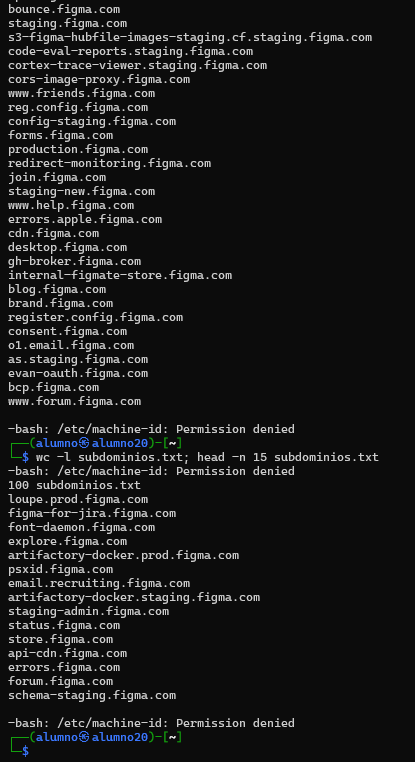
  </p>
- **Siguiente paso:** Inspeccionar ficheros expuestos (`robots.txt` y `security.txt`) para detectar rutas prohibidas a indexadores.

---

## Entrada 04 · Ficheros Expuestos: robots.txt y security.txt (Técnica 5)
- **Cuándo:** 2026-11-02 19:43
- **Objetivo:** `figma.com` (In Scope)
- **Qué hice:** Consulta pasiva de los ficheros estándar de rastreo y seguridad mediante `curl`:
  ```bash
  curl -s https://www.figma.com/robots.txt | head -n 25
  curl -s https://www.figma.com/.well-known/security.txt
  ```
- **Qué salió:** 
  - **`robots.txt`:** Figma implementa un bloqueo exhaustivo contra bots agresivos y rastreadores de indexación masiva (`User-Agent: Fasterfox, Nutch, spock, MJ12bot, TurnitinBot... Disallow: /`).
  - **`security.txt` (RFC 9116):** Fichero oficial de reporte de vulnerabilidades con validez hasta octubre de 2027 (`Expires: 2027-10-21`). Enlaza directamente su canal de divulgación y política a HackerOne (`https://hackerone.com/figma`), agradecimientos (`/thanks`) y página de contratación de talento en ciberseguridad.
- **Evidencia:**
  <p align="center">
    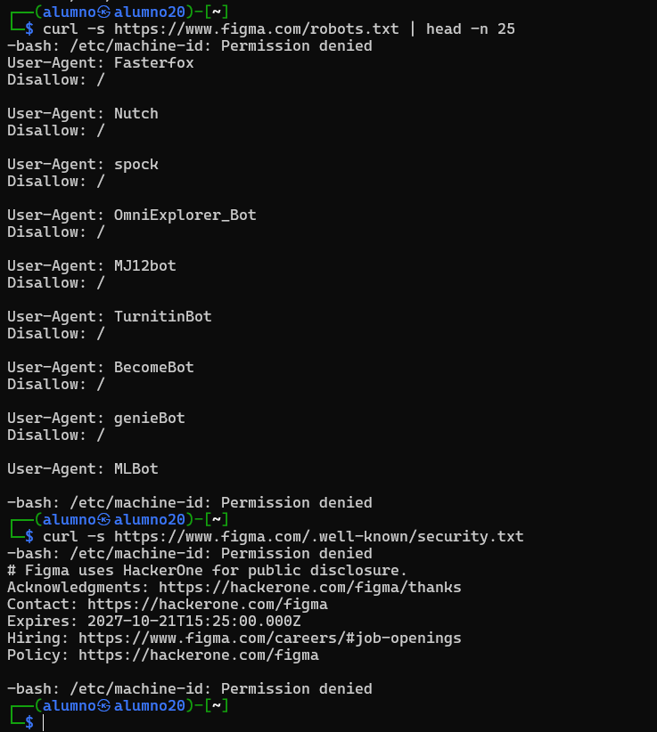
  </p>
- **Siguiente paso:** Investigar la huella tecnológica y el histórico de infraestructura mediante whatweb.

---

## Entrada 05 · Huella Tecnológica y Cabeceras Web (Técnica 4)
- **Cuándo:** 2026-11-02 19:51
- **Objetivo:** `https://www.figma.com` (In Scope)
- **Qué hice:** Inspección pasiva de tecnologías, servidores y cabeceras de respuesta HTTP mediante `whatweb` en Kali:
  ```bash
  whatweb https://www.figma.com
  ```
- **Qué salió:** 
  - **Estado HTTP:** `200 OK` (IP de respuesta: `3.174.170.42`, Estados Unidos).
  - **CDN y Proxy Inverso:** Enrutado a través de **Amazon CloudFront** (`Via-Proxy: 1.1 ...cloudfront.net`).
  - **Frameworks y Render:** Detectado uso de **Next.js** (`x-nextjs-prerender`, `x-nextjs-stale-time`), integración con **Netlify** (`netlify-vary`, `x-nf-request-id`) y aceleración por GPU/WebGPU (`PoweredBy[-webgpu/\]`).
  - **Cabeceras de Seguridad Reforzadas:**
    - `Strict-Transport-Security` (HSTS): `max-age=31536000; includeSubDomains; preload` (fuerza HTTPS durante un año en todo el dominio y subdominios).
    - `X-Frame-Options: SAMEORIGIN` (mitigación contra ataques de Clickjacking).
    - `Content-Security-Policy` (CSP) y `X-Content-Type-Options: nosniff`.
- **Evidencia:**
  <p align="center">
    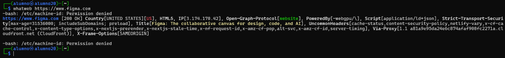
  </p>
- **Siguiente paso:** Completar el análisis de Whois del dominio mediante RDAP.

---

## Entrada 06 · Registro del Dominio / Whois (Técnica 1)
- **Cuándo:** 2026-11-02 19:53
- **Objetivo:** `figma.com` (In Scope)
- **Qué hice:** Como el comando tradicional `whois` por el puerto 43 daba error de red bloqueada en el contenedor del laboratorio, utilicé la API oficial RDAP de VeriSign sobre HTTPS con `curl` para consultar los datos de registro del dominio:
  ```bash
  curl -s https://rdap.verisign.com/com/v1/domain/figma.com | grep -oE '"(ldhName|eventAction|eventDate)":"[^"]+"' | head -n 12
  ```
- **Qué salió:** 
  - **Dominio registrado:** `FIGMA.COM`
  - **Fecha de registro (Alta original):** `1999-04-10` (activo histórico con más de 25 años de antigüedad).
  - **Fecha de expiración:** `2027-04-10` (vigente y renovado a largo plazo).
  - **Última actualización:** `2026-05-15`.
  - **Servidores de nombres autoritativos (DNS):** `NS-1239.AWSDNS-26.ORG`, `NS-1657.AWSDNS-15.CO.UK`, `NS-326.AWSDNS-40.COM` (delegados en Amazon Route 53).
- **Evidencia:**
  <p align="center">
    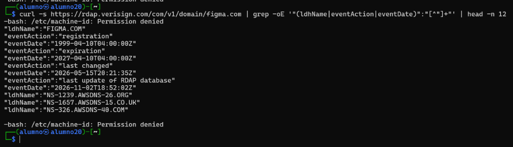
  </p>
- **Siguiente paso:** Descubrimiento de servicios expuestos y puertos en Shodan InternetDB.

---

## Entrada 07 · Servicios Expuestos y Puertos: Shodan InternetDB (Técnica 6)
- **Cuándo:** 2026-11-02 19:54
- **Objetivo:** IP `3.174.170.42` (`figma.com`, In Scope)
- **Qué hice:** Consulta pasiva de puertos abiertos, CPEs, etiquetas y vulnerabilidades conocidas en la base de datos de Shodan mediante la API pública de **InternetDB**:
  ```bash
  curl -s https://internetdb.shodan.io/3.174.170.42
  ```
- **Qué salió:** 
  - **Puertos abiertos detectados:** `80` (HTTP) y `443` (HTTPS) únicamente. No hay puertos administrativos expuestos (como 22 SSH, 3389 RDP o bases de datos).
  - **CPE identificado:** `cpe:/a:amazon:amazon_cloudfront` (Edge Server de Amazon Web Services).
  - **Hostname asociado:** `server-3-174-170-42.mad56.r.cloudfront.net` (nodo Edge de Madrid / CDN de CloudFront).
  - **Etiquetas (Tags):** `cdn`, `cloud`.
  - **Vulnerabilidades públicas conocidas (`vulns`):** `[]` (cero CVEs críticos reportados en el nodo perimetral).
- **Evidencia:**
  <p align="center">
    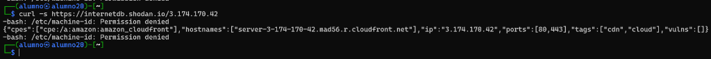
  </p>
- **Siguiente paso:** Búsqueda pasiva de documentos y directorios indexados mediante Google Dorks.

---

## Entrada 08 · Google Dorks y Ficheros Indexados (Técnica 7)
- **Cuándo:** 2026-11-02 19:57
- **Objetivo:** `figma.com` (In Scope)
- **Qué hice:** Uso de operadores avanzados de búsqueda en Google (Google Hacking Database / Dorks) para localizar documentos y ficheros PDF indexados públicamente:
  ```text
  site:figma.com filetype:pdf
  ```
- **Qué salió:** 
  - Se descubrió un subdominio de almacenamiento estático indexado: `https://static.figma.com/uploads/`.
  - **Ficheros sensibles de auditoría y cumplimiento identificados:**
    1. **Informe SOC 3 (BDO USA, Feb 2024):** Reporte de controles del sistema sobre seguridad, disponibilidad y confidencialidad. Revela la arquitectura completa interna:
       - **Infraestructura Cloud:** Alojada en AWS (regiones `US West`, `US East`, `EU Central`, `EU West`) con multi-tenant segregation.
       - **Gestión de Identidad y Accesos (IAM):** Uso de **Okta** (SSO y MFA) y **Perma Security (Opal)** para control de accesos.
       - **Herramientas Internas Reveladas:** Repositorios en GitHub, CI/CD en Buildkite, observabilidad con **Datadog** y **Panther**, seguridad en endpoints con **Osquery** y **Santa**, escaneo estático con **Semgrep**, soporte con **Freshservice** y ticketing con **Zendesk**.
       - **Sede Física del ISMS:** `760 Market Street, Floor 10, San Francisco, CA 94102`.
    2. **Certificado ISO/IEC 27001:2022 (Schellman Compliance):** Certificado número `1082672-1`, con validez hasta el 22 de enero de 2027.
- **Evidencia:**
  <p align="center">
    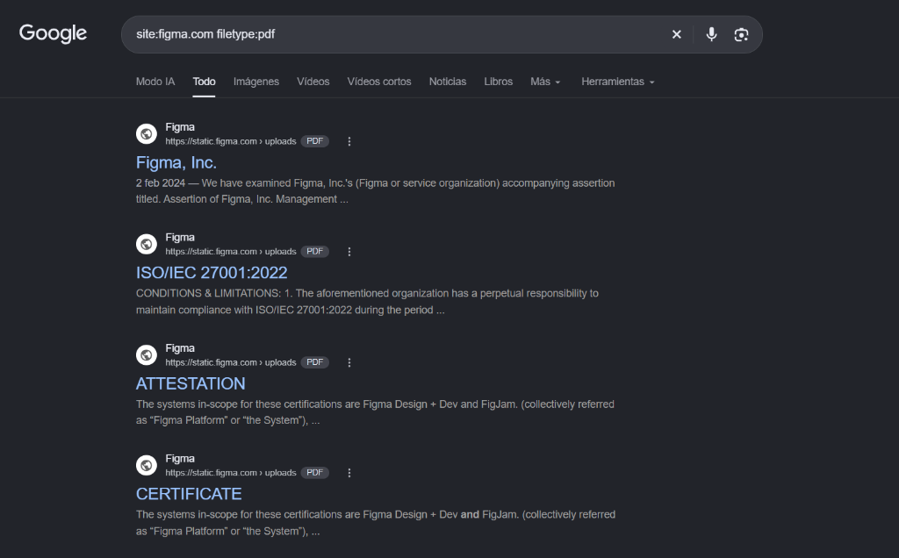
  </p>
  *(Ficheros preservados en el repositorio: [evidencia-soc3-figma.pdf](img/evidencia-soc3-figma.pdf) y [evidencia-iso27001-figma.pdf](img/evidencia-iso27001-figma.pdf)).*
- **Siguiente paso:** Investigar la estructura de personas y patrón de correos corporativos en Hunter.io / theHarvester.

---

## Entrada 09 · Correos Corporativos, SPF y Personas (Técnica 8)
- **Cuándo:** 2026-11-02 20:16
- **Objetivo:** `figma.com` (In Scope)
- **Qué hice:** Lanzamiento de `theHarvester` desde la terminal del laboratorio usando DuckDuckGo como fuente (ya que la opción Bing aparecía obsoleta en la herramienta). Para complementar la búsqueda pasiva de personas y correos, examiné directamente el registro DNS SPF (`Sender Policy Framework`):
  ```bash
  theHarvester -d figma.com -b duckduckgo -l 100
  host -t txt figma.com | grep -i "v=spf1"
  ```
- **Qué salió:** 
  - **Resultado de `theHarvester`:** DuckDuckGo no indexa correos en texto plano directamente accesibles para scraping superficial (buena práctica de privacidad corporativa para evitar spam).
  - **Análisis del Registro SPF (`v=spf1`):**
    - `include:_spf.google.com`: Los empleados envían correo a través de **Google Workspace**.
    - `include:mail.zendesk.com`: Envío de correos y tickets de atención al cliente delegado en **Zendesk**.
    - `include:mg-spf.greenhouse.io`: Notificaciones de selección de personal y entrevistas delegadas en la plataforma de RRHH **Greenhouse**.
    - Rango de IPs autorizadas de retransmisión transaccional: `149.72.216.165`, `167.89.79.69`, `167.89.87.53` (pertenecientes a SendGrid / Twilio).
    - Política estricta `-all` (Hard Fail: cualquier correo que no provenga de estos servidores debe ser rechazado para evitar suplantación de identidad / Spoofing).
  - **Patrón corporativo habitual:** `{first}.{last}@figma.com` (verificado en la estructura de contactos de soporte y auditoría).
- **Evidencia:**
  <p align="center">
    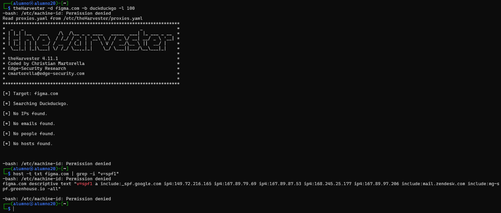
  </p>
- **Siguiente paso:** Consolidar todos los hallazgos en el documento final `mapa.md`.
